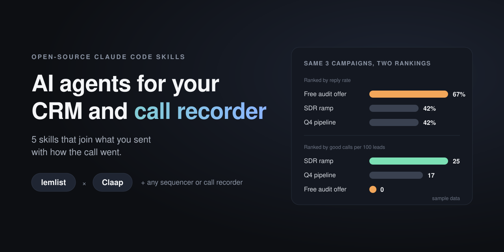
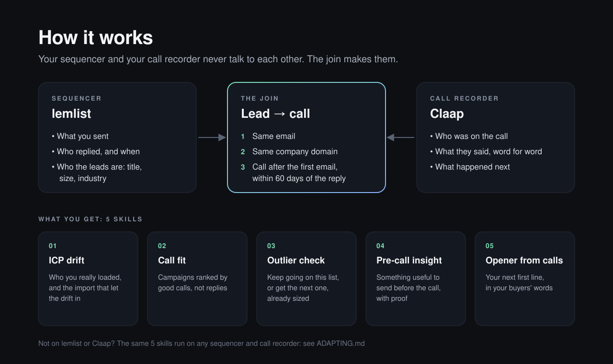

<p align="center">
  
</p>

<p align="center">
  
  
  
</p>

# AI agents for your CRM and call recorder

**5 Claude Code skills that join your outbound tool and your call recorder: lemlist x Claap out of the box, any CRM, sequencer or call recorder with [ADAPTING.md](ADAPTING.md).**

Your sequencer knows what you sent. Your call recorder knows how the call went. They have never spoken to each other, so everybody optimises reply rate and nobody optimises the conversation that follows.

These 5 AI agents join the two, starting with lemlist and Claap.

<p align="center">
  
</p>

| # | Skill | What it answers |
|---|---|---|
| 1 | `lemlist-claap-icp-drift` | Is the ICP I loaded into my last campaigns still the one I'm positioned for? Which import let the drift in, and what share of my replies came from outside the ICP? |
| 2 | `lemlist-claap-call-fit` | Who actually turned up on the calls each campaign produced? Campaigns ranked by good calls per 100 leads, not reply rate. |
| 3 | `lemlist-claap-outlier-check` | Was the deal I closed an outlier, or does the rest of the list share its context? Who to contact first, or the next list, already sized. |
| 4 | `lemlist-claap-pre-call-insight` | Someone replied. What useful thing do I send them before the call, with proof from a company like theirs? Plus a prep note for me. |
| 5 | `lemlist-claap-opener-from-calls` | What did buyers say on calls that went somewhere, what's my next first line, and how do I know it won on calls, not just replies? |

Plus `lemlist-claap-setup`, which connects both tools, measures how complete your lead data is, and proves the join works on your account.

## Start
Follow [SETUP.md](SETUP.md). Short version: clone, connect lemlist and Claap (claude.ai connectors or `/mcp`), open Claude Code in the folder, then say **"set up the playbook"**.

## Not on lemlist or Claap?
The logic works with any sequencer and call recorder that can answer a short list of questions. [ADAPTING.md](ADAPTING.md) lists them, and gives you the prompt that has Claude Code remap the skills to your tools and test them on your account.

## What it will never do
- Send an email, launch, pause or start a campaign, or change a live sequence without your yes
- Create Claap fields, views or automations without asking (they apply to the whole workspace)
- Spend enrichment credits without asking
- Make up a number. Everything in a report comes from your data in that run.
- Quote a prospect from an AI summary. Quotes come from the transcript, word for word.

## Layout
```
.mcp.json                 lemlist (as "lem") + Claap servers (OAuth, no keys)
CLAUDE.md                 tool map, join rules, quoting rules, safety rules
SETUP.md                  step-by-step connection guide
ADAPTING.md               run the playbook on other tools
.claude/skills/<name>/    one folder per skill
assets/                   banner, diagram, social preview image
docs/                     your ICP + connection notes (written by setup, git-ignored)
reports/                  outputs (git-ignored)
```

Tool behaviour last verified live against both servers on 2026-10-28.

MIT licensed. Built by Othmane Khadri.
